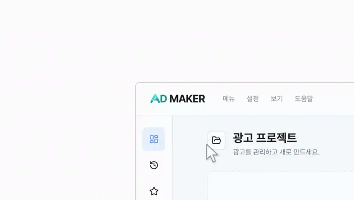

# Admaker

**광고 영상을 기획부터 생성·편집·내보내기까지 한 곳에서 만드는 AI 광고 영상 에디터**의 데스크톱 앱 배포 저장소입니다.

미리보기를 누르면 소리가 있는 1080p 영상(mp4)을 볼 수 있습니다.

이 저장소에는 설치 파일과 릴리스 노트만 올라옵니다. 소스 코드는 공개하지 않습니다.

## 소개

Admaker 는 상품·매장 정보만 넣으면 광고 기획안, 장면 구성, 이미지·영상·음악·내레이션까지 AI 로 만들어 바로 편집할 수 있게 해 주는 광고 영상 제작 도구입니다.

| 모드 | 하는 일 |
|------|---------|
| **Quick** | 사진 몇 장과 매장 정보로 짧은 광고 영상을 빠르게 완성 |
| **Planner** | 광고 기획안과 스토리보드를 만들고 장면별로 다듬은 뒤 영상으로 생성 |
| **Studio** | 타임라인 편집기. 텍스트·스티커·전환 효과·모자이크·자막, AI 이미지·영상·BGM·보이스 생성 |

데스크톱 앱은 웹 버전과 같은 기능에 더해 다음을 제공합니다.

- 큰 영상도 내 PC 에서 바로 인코딩해 저장하는 로컬 내보내기
- 작업 폴더의 사진·영상·자막 파일을 바로 불러오기
- AI 에이전트(Agent) 연결로 대화하며 광고 만들기

## 다운로드

[최신 릴리스](https://github.com/shaneParkKt/admaker-public/releases/latest)에서 운영체제에 맞는 파일을 받으세요.

| OS | 파일 | 설치 |
|----|------|------|
| Windows | `Admaker-<버전>-win-setup.exe` | 설치 마법사를 따라 설치합니다. 바탕화면·시작 메뉴 바로가기가 만들어집니다. |
| macOS | `Admaker-<버전>-mac.pkg` | Apple Silicon·Intel 겸용입니다. 처음 열 때 막히면 **시스템 설정 → 개인정보 보호 및 보안 → 그래도 열기**를 누르세요. 설치가 끝나면 앱이 바로 실행됩니다. |

## 릴리스 노트

새 버전이 나올 때마다 아래에 변경 사항이 자동으로 추가됩니다 (최근 10개). 전체 기록은 [Releases](https://github.com/shaneParkKt/admaker-public/releases)에서 볼 수 있습니다.

<!-- releases:start -->
### 1.11.0 (2026-11-24)

[다운로드](https://github.com/shaneParkKt/admaker-public/releases/tag/admaker-app-v1.11.0)

#### 새 기능
- Agent CLI 자동 설치 + 실패 시 수동 설치 안내
<!-- releases:end -->

## 라이선스

Copyright (c) 2026 KT Corporation. All rights reserved.

배포되는 앱은 KT 의 독점 소프트웨어입니다. KT 의 사전 서면 허가 없이 복제, 수정, 배포, 외부 공개할 수 없으며, 리버스 엔지니어링·디컴파일과 이를 통한 재구현을 금지합니다. 전문은 [LICENSE](./LICENSE)를 참고하세요.
